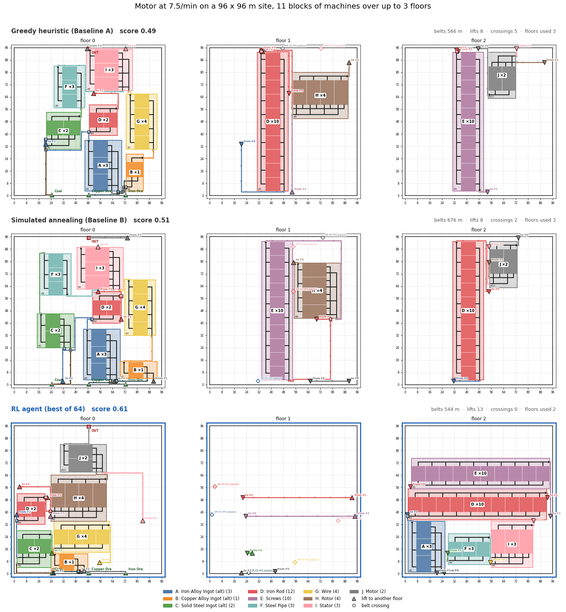

# Satisfactory AI

An AI that designs and builds factories in the game Satisfactory. You give it a target item and rate,
like "10 Reinforced Iron Plate per minute", and it figures out the production chain, picks a
spot in the world, designs the layout for machines and belts, and builds the factory in a running game.

The layout step is the unique part, and it is learned with reinforcement learning. Everything else
is done with standard algorithms.

<p align="center">
  
</p>

## Status

The RL layout agent is finished, and currently has one model per stage of a 5-stage curriculum, each starting with weights from
the previous stage's model.

- On 38 items it never trained on, it beats Baseline B on average with zero broken layouts, and is
  about 4x faster (see [Final verification](#final-verification-items-it-never-trained-on)).
- Next: building the agent's layouts in-game at scale, then a single command that runs the whole
  pipeline.

## How it works

1. **Solve** (`solver/`): turns the target into a production graph that outlines which recipes, how many
   machines, and how many items per minute on every belt. Done with a small linear program over the
   game's data files.
2. **Site** (`siting/`): picks a flat, buildable rectangle close to the raw resources (Dijkstra's) it
   needs, using a terrain map read from the game.
3. **Layout** (`layout/`): places the machines on a grid of 1 m cells over up to three
   floors, then routes belts, lifts, splitters and mergers between them. This is set up as
   a game for an agent:
   - The agent places one *block* at a time (a row of identical machines). Each turn it
     picks how many machines go in the row, then a rotation, floor and position.
   - Illegal moves (such as overlaps and out of bounds) are masked out exactly, so every action the
     agent can take is valid.
   - When all blocks are placed, a router connects them (implemented as A* with retry and history cost, sped
     up with Numba) and a flow check confirms the right rates reach the right machines.
   - The score rewards valid factories with short belts, few lifts and belt crossings,
     little wasted space and as few floors as needed.
4. **Build** (`executor/` + `mod/`): the layout becomes a *FactoryPlan* (see
   [docs/factoryplan.md](docs/factoryplan.md)). A C++ mod running inside the game
   (using an HTTP server on localhost) reads it and spawns every foundation, machine and belt.

## The RL agent

- **Policy** (`layout/policy.py`, 1.35M parameters): a CNN over the site grid (3 floors) and a
  cost map, a graph network over the recipe graph, and a U-Net decoder with one output per
  position on a 2 m grid.
- **Training** (`rl/`, `layout/train.py`): PPO with a group baseline. Every task is played 8-16
  times, and each game is graded against the average of its other copies, so no value network
  is needed to judge a move. Games are played by 16 worker processes, and the next batch is
  played in the background while the network learns from the current one.
- **Curriculum:** each stage adds bigger target items. A new stage starts from the previous
  stage's model, softened (more random) so it explores again.
- **Using it** (`layout/design.py`): every stage's model takes 8 samples, then the model with the
  best layout takes 56 more, and the best of all 96 is kept ("scout" mode). About 2.5 s per task,
  compared with ~10 s for Baseline B.

The full training log, with every run, what it changed and what it taught me, is in
[docs/training.md](docs/training.md).

## Results so far

Two non-RL baselines for the agent to compare against:

- **A, greedy:** places blocks one by one in the cheapest legal spot (belt estimate + a
  walkway bonus). Runs in ~35 ms per task.
- **B, simulated annealing:** starts from A and tries N random changes (shift, rotate,
  swap, re-split rows), keeping the best. Takes 4-31 s per task.

Mean score (max 1) on the fixed test set: tasks never used for training, counting only tasks
Baseline A can solve. *greedy* is one try per task; *best-of-64* keeps the best of 64 samples.

| Stage | Example targets | A | B | Agent greedy | Agent best-of-64 |
|---|---|---|---|---|---|
| 1 | Iron Plate, Iron Rod, Wire | 0.726 | 0.757 | 0.760 | **0.769** |
| 2 | Reinforced Iron Plate, Rotor | 0.605 | **0.658** | 0.607 | 0.654 |
| 3 | Modular Frame, Encased Industrial Beam | 0.599 | **0.653** | 0.561 | 0.649 |
| 4 | Motor, Heavy Modular Frame | 0.532 | 0.569 | 0.517 | **0.594** |
| 5 | Computer | 0.511 | 0.539 | 0.528 | **0.597** |

On stages 2 and 3, best-of-64 is level with B (within 0.004).

### Final verification: items it never trained on

The final test was 152 tasks for 38 target items that no stage trained on (Stator, Smart Plating,
Nobelisk, Uranium Fuel Rod, ...), counting only the 140 that Baseline A can solve. Three ways of using
the five stage models are compared:

- **all:** best-of-64 with every model (320 games).
- **greedy:** one greedy game per model, then best-of-64 with the one that scored highest (69 games).
- **scout:** best-of-8 per model, then 56 more games with the one that scored highest (96 games).

| Method | Mean score | vs B (paired, SE) | Matches or beats B | Broken | Time per task |
|---|---|---|---|---|---|
| Baseline A | 0.661 | | | | 0.14 s |
| Baseline B | 0.699 | | | | 10.0 s |
| Agent, all | **0.710** | +0.012 (0.003) | 70% | 0 | 5.8 s |
| Agent, scout | 0.706 | +0.007 (0.003) | 68% | 0 | **2.5 s** |
| Agent, greedy | 0.703 | +0.005 (0.003) | 62% | 0 | 1.6 s |

- **Scout is the default:** within 0.005 of "all" at less than half the
  time, and about 4x faster than B. Times are wall-clock on one machine and B uses one CPU core per task,
  the agent uses 16 workers and a GPU.
- **Weak spots:** B is clearly better on Cable, Concrete and Stator (by 0.03-0.04) and on SAM
  Fluctuator (by 0.01).

Reproduce it with `python -m layout.verify` (~30 min), or print the saved results with `--show`.

## Repo layout

```
solver/     production graph from a target item and rate
siting/     terrain map and site search
layout/     the layout environment, router, score, baselines, policy and training script
rl/         PPO, rollout buffers, parallel game workers
tools/      run registry, run comparison, job queue, supervisor and MCP server
executor/   FactoryPlan format, HTTP bridge to the mod, build and verify
mod/        SatAIBridge, the Unreal / C++ game mod
data/       parsed game data, building catalog, cached test set
docs/       FactoryPlan format and training notes
models/     the trained model of each finished stage (weights only)
tests/      pytest tests, one folder per package
runs/       training runs, checkpoints and the registry (not in git)
```

## Running it

Python 3.10 with numpy, scipy, matplotlib, numba, gymnasium and PyTorch (CUDA recommended for
training). For the run tools: psutil, tensorboard and mcp. Run everything as a module from the
repo root.

```
python -m layout.view --seed 3 --out random.png       # a random agent's layout
python -m layout.baseline --seed 3 --out greedy.png   # Baseline A
python -m layout.anneal --seed 3 --out anneal.png     # Baseline B
python -m layout.testset --show                       # test set results table
```

### Try the trained models

`models/` holds the best trained model of each finished stage, the ones behind the results table,
with only the network weights (5.4 MB each):

| File | Stage | Greedy | Best-of-64 |
|---|---|---|---|
| `models/stage1.pt` | 1 | 0.760 | 0.769 |
| `models/stage2.pt` | 2 | 0.607 | 0.654 |
| `models/stage3.pt` | 3 | 0.561 | 0.649 |
| `models/stage4.pt` | 4 | 0.517 | 0.594 |
| `models/stage5.pt` | 5 | 0.528 | 0.597 |

Design a layout for any supported item and rate with all five models, compared with Baseline A
(`--b` adds Baseline B, `--out` saves a picture):

```
python -m layout.design Stator 10
python -m layout.design "Smart Plating" 2 --site 64x48 --b --out plating.png
```

Play a single model on one test task, compare it with both baselines and save a picture like the one at
the top (a few seconds with a GPU):

```
python -m layout.try_model models/stage4.pt                                    # list the stage's test tasks
python -m layout.try_model models/stage4.pt --task 57004 --out motor.png       # play one of them
```

To reproduce a whole row of the results table, score a model on every test task of its stage:

```
python -m layout.best_of models/stage4.pt --stage 4 --k 64
```

Training and scoring a model (all flags are explained in [docs/training.md](docs/training.md)):

```
python -m layout.train --run my_run --stage 4 --rounds 2000 --copies 16 --groups 7 --fixed-scale --solvable --cost-map --async-play --overlap --lag fix --lr 1e-4 --init <checkpoint> --note "what this run changes"
python -m layout.best_of runs/stage4/my_run/last.pt --stage 4 --k 64 --save plans.json
```

Managing runs:

```
python -m tools.jobs add ...          # queue a run (each needs a note and a prereg text)
python -m tools.supervisor            # work through the queue, stopping runs that crash, hang or run out of RAM
python -m tools.compare a b           # paired comparison of two runs on the test set
```

`tools/server.py` is an MCP server that exposes the registry, the comparisons and the queue, so
an AI assistant like Claude can read results and start or stop runs.

Building in-game needs Satisfactory 1.2 with the mod loaded (See [Official Guide](https://docs.ficsit.app/satisfactory-modding/latest/index.html)) and a creative save:

```
python -m executor.build tests/plans/iron_plate_2smelter.json
```

## Scope (v1)

Solid items only (no fluids), power and building costs turned off, one target item per run.

## License

MIT