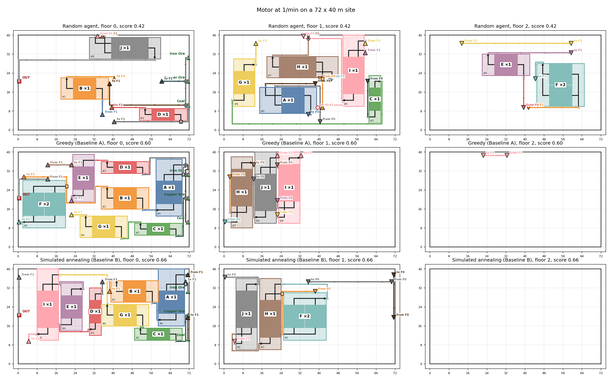

# Satisfactory AI

An AI that designs and builds factories in the game Satisfactory. You give it a target item and rate,
like "10 Reinforced Iron Plate per minute", and it figures out the production chain, picks a
spot in the world, designes the layout for machines and belts, and builds the factory in a running game.

The layout step is the unique part, and it is the part being learned with reinforcement
learning. Everything else is done through standard algorithms.



## Status

Work in progress. The pipeline works end to end with random/baseline layouts, and the RL agent
that should replace them is what I'm building now.

## How it works

1. **Solve** (`solver/`): turns the target into a production graph that outlines which recipes, how many
   machines, and how many items per minute on every belt. Done with a small linear program over the
   game's data files.
2. **Site** (`siting/`): picks a flat, buildable rectangle close to the raw resources (dikjstra's) it
   needs, using a terrain map read from the game.
3. **Layout** (`layout/`): places the machines on a grid of 1 m cells over up to three
   floors, then routes belts, lifts, splitters and mergers between them. This is set up as
   a game for an agent:
   - The agent places one *block* at a time (a row of identical machines). Each turn it
     picks how many machines go in the row, then a rotation, floor and position.
   - Illegal moves (such as overlaps and out of bounds) are masked out exactly, so every action the
     agent can take is valid.
   - When all blocks are placed, a router connects them (implemented as A* with retry and history cost, sped
     up with Numba) and a flow check confirms the right rates reach the right machines.
   - The score rewards valid factories with short belts, few lifts and belt crossings,
     little wasted space and as few floors as needed.
4. **Build** (`executor/` + `mod/`): the layout becomes a *FactoryPlan* (see
   [docs/factoryplan.md](docs/factoryplan.md)). A C++ mod running inside the game
   (using an HTTP server on localhost) reads it and spawns every foundation, machine and belt.

## Results so far

Two non-RL baselines for the agent to compare against:

- **A, greedy:** places blocks one by one in the cheapest legal spot (belt estimate + a
  walkway bonus). Runs in ~35 ms per task.
- **B, simulated annealing:** starts from A and tries N random changes (shift, rotate,
  swap, re-split rows), keeping the best. Takes 4-31 s per task.

Following is the median score of valid layouts (with max score being 1) on a fixed test set of 100 tasks (10 target items between 5 difficulty stages that are never used for training):

| Stage | Example targets | A | B |
|---|---|---|---|
| 1 | Iron Plate, Iron Rod, Wire | 0.70-0.74 | 0.74-0.76 |
| 2 | Reinforced Iron Plate, Rotor | 0.57-0.63 | 0.60-0.66 |
| 3 | Modular Frame, Encased Industrial Beam | 0.59-0.65 | 0.66-0.69 |
| 4 | Motor, Heavy Modular Frame | 0.51-0.53 | 0.55 |
| 5 | Computer | 0.48 | 0.51 |

**Current Goal** an RL model that beats A on every task and matches or beats B more than 50% of the time (taking much shorter to run than B)

## Repo layout

```
solver/     production graph from a target item and rate
siting/     terrain map and site search
layout/     the layout environment, router, score, baselines, Gymnasium wrapper
executor/   FactoryPlan format, HTTP bridge to the mod, build and verify
mod/        SatAIBridge, the Unreal / C++ game mod
data/       parsed game data, building catalog, cached test set
tests/      tests for modules that require extra checks
```

## Running it

Python 3.10 with numpy, scipy, matplotlib, numba and gymnasium. You can run everything as a module from the repo root.

```
python -m layout.view --seed 3 --out random.png       # a random agent's layout
python -m layout.baseline --seed 3 --out greedy.png   # Baseline A
python -m layout.anneal --seed 3 --out anneal.png     # Baseline B
python -m layout.testset --show                       # test set results table
```

Building in-game needs Satisfactory 1.2 with the mod loaded (See [Official Guide](https://docs.ficsit.app/satisfactory-modding/latest/index.html)) and a creative save:

```
python -m executor.build tests/plans/iron_plate_2smelter.json
```

## Scope (v1)

Solid items only (no fluids), power and building costs turned off, one target item per run.

## License

MIT